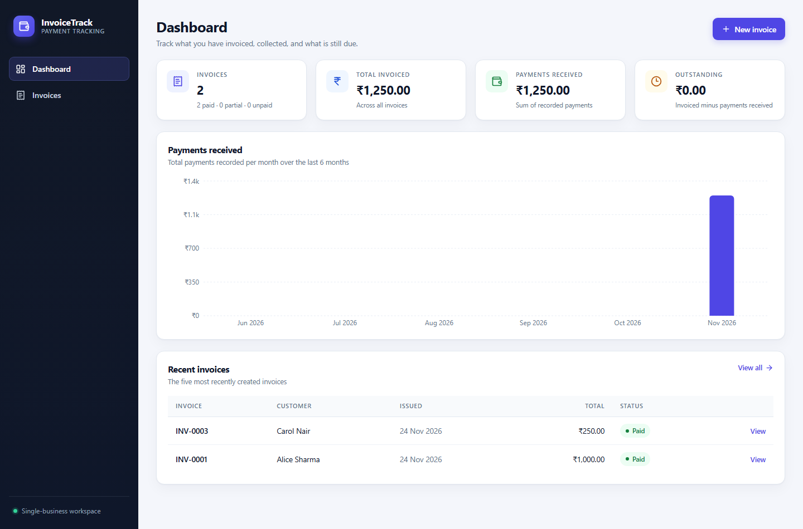
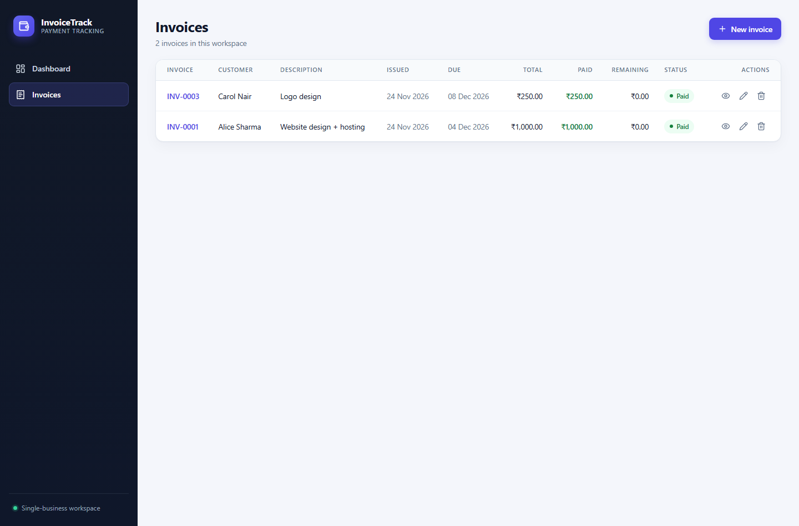
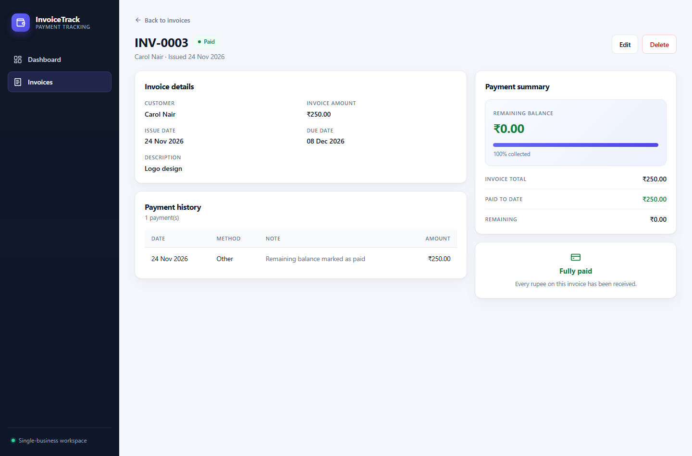

# InvoiceTrack — Invoice & Payment Tracking System

A small MERN application for a single business owner to create invoices, record full or partial
payments, and see what has been collected versus what is still outstanding.

The scope is intentionally narrow: invoices, payments, automatic status calculation, dashboard
totals, and one payments chart. There is no authentication, customer module, tax engine, or PDF
generation.

## Contents

- [Features](#features)
- [Tech stack](#tech-stack)
- [Architecture](#architecture)
- [Project structure](#project-structure)
- [Database design](#database-design)
- [Business logic](#business-logic)
- [API reference](#api-reference)
- [Setup](#setup)
- [Environment variables](#environment-variables)
- [Running the application](#running-the-application)
- [Screenshots](#screenshots)
- [Verification performed](#verification-performed)
- [Known limitations](#known-limitations)
- [Future enhancements](#future-enhancements)

## Features

- Create, view, edit, and delete invoices.
- Automatic sequential invoice numbers (`INV-0001`, `INV-0002`, ...) that are not reused after a
  deletion.
- Record multiple payments against one invoice, including partial payments.
- "Mark as paid" action that records a payment for the exact remaining balance.
- Paid amount, remaining amount, and status are never entered manually; they are derived from the
  payments collection.
- Overpayment is rejected by the API.
- An invoice amount cannot be edited below the amount already paid.
- Deleting an invoice also deletes its payments.
- Dashboard totals: number of invoices, total invoiced, total received, total outstanding, and
  counts of paid / partially paid / unpaid invoices.
- One chart: payments received per month over the last six calendar months (Recharts).
- Invoice detail page with payment history, progress bar, and payment form.
- Responsive layout: sidebar on desktop, top navigation on mobile; secondary table columns collapse
  on small screens.
- Basic loading, empty, error, and success states; confirmation dialogs before delete and mark-paid.

## Tech stack

### Client

| Package | Version | Purpose |
| --- | --- | --- |
| React | 19.3 | UI |
| Vite | 8.3 | Dev server and build |
| React Router DOM | 7.18 | Client-side routing |
| Axios | 1.21 | HTTP client |
| Recharts | 3.11 | Monthly payments bar chart |
| Lucide React | 1.78 | Icons |

Plain CSS is used (no UI framework). Currency is formatted as INR (`en-IN`).

### Server

| Package | Version | Purpose |
| --- | --- | --- |
| Node.js | 24.22 tested | Runtime |
| Express | 5.3 | REST API |
| Mongoose | 8.24 | MongoDB ODM |
| Helmet | 8.1 | HTTP security headers |
| CORS | 2.8 | Restricts browser origin to `CLIENT_ORIGIN` |
| Morgan | 1.10 | Dev request logging |
| dotenv | 16.6 | Environment variables |

MongoDB 7 was used for testing (Docker image `mongo:7`). The code does not use MongoDB
transactions, so it runs on a standalone MongoDB instance.

## Architecture

```
React (Vite dev server :5173)
        │  axios, baseURL "/api"
        ▼
Vite dev proxy  ──────────────►  Express API (:5000)
                                     │
                                     ▼
                            MongoDB (invoices, payments, counters)
```

- The client calls `/api/...`; Vite proxies those requests to `http://localhost:5000` during
  development. CORS on the server allows only `CLIENT_ORIGIN`.
- The API calculates payment summaries on read. `paidAmount`, `remainingAmount`, and `status` are
  not stored on the invoice document, which keeps them consistent with the payments collection.
- The server is split into models, controllers, routes, utilities, and one error-handling
  middleware. Express 5 forwards rejected async handlers to that middleware automatically.

## Project structure

```
Payment tracking system/
├── client/
│   ├── public/
│   │   └── favicon.svg
│   ├── src/
│   │   ├── api/
│   │   │   ├── client.js              # axios instance + error normalization
│   │   │   └── invoices.js            # API wrapper functions
│   │   ├── components/
│   │   │   ├── Layout.jsx             # sidebar / mobile top nav
│   │   │   ├── States.jsx             # loading, empty, error, success UI
│   │   │   └── StatusBadge.jsx
│   │   ├── pages/
│   │   │   ├── Dashboard.jsx          # totals, chart, recent invoices
│   │   │   ├── Invoices.jsx           # invoice table + delete
│   │   │   ├── InvoiceDetail.jsx      # history, payments, mark paid, delete
│   │   │   └── InvoiceForm.jsx        # create and edit
│   │   ├── utils/format.js            # currency and date formatting
│   │   ├── App.jsx
│   │   ├── index.css
│   │   └── main.jsx
│   ├── index.html
│   ├── package.json
│   └── vite.config.js
├── server/
│   ├── config/db.js
│   ├── controllers/
│   │   ├── invoiceController.js
│   │   └── dashboardController.js
│   ├── middleware/errorHandler.js
│   ├── models/
│   │   ├── Counter.js                 # invoice number sequence
│   │   ├── Invoice.js
│   │   └── Payment.js
│   ├── routes/
│   │   ├── invoiceRoutes.js
│   │   └── dashboardRoutes.js
│   ├── utils/
│   │   ├── calculations.js            # rounding + derived status/summary
│   │   └── invoiceNumber.js           # counter initialization + next number
│   ├── .env.example
│   ├── package.json
│   └── server.js
├── docs/
│   ├── project-brief.md               # original project brief, kept for reference
│   └── screenshots/
├── .gitignore
└── README.md
```

## Database design

Database name in the example configuration: `invoice_tracker`.

### `invoices`

| Field | Type | Rules |
| --- | --- | --- |
| `_id` | ObjectId | Primary key |
| `invoiceNumber` | String | Required, unique, generated by the server (`INV-0001`) |
| `customerName` | String | Required, trimmed, max 100 characters |
| `description` | String | Required, trimmed, max 500 characters |
| `amount` | Number | Required, greater than 0 |
| `issueDate` | Date | Defaults to the current time if omitted |
| `dueDate` | Date or null | Optional; cannot be before `issueDate` |
| `notes` | String | Optional, max 500 characters |
| `createdAt` / `updatedAt` | Date | Mongoose timestamps |

`paidAmount`, `remainingAmount`, and `status` are **derived fields added to API responses**; they
are not persisted on this document.

### `payments`

| Field | Type | Rules |
| --- | --- | --- |
| `_id` | ObjectId | Primary key |
| `invoice` | ObjectId | Required, references `invoices._id`, indexed |
| `amount` | Number | Required, greater than 0, cannot exceed the invoice's remaining balance |
| `method` | String | `Cash`, `UPI`, `Bank Transfer`, `Card`, or `Other` (default `Other`) |
| `date` | Date | Defaults to now; used by the monthly chart |
| `note` | String | Optional, max 200 characters |
| `createdAt` / `updatedAt` | Date | Mongoose timestamps |

### `counters`

Internal collection used for invoice numbering.

| Field | Type | Notes |
| --- | --- | --- |
| `_id` | String | Fixed value `"invoice"` |
| `seq` | Number | Atomically incremented with `$inc` |

On startup the server raises the counter to at least the highest existing invoice number, then uses
`findByIdAndUpdate(..., { $inc: { seq: 1 } }, { upsert: true })` for each new invoice. Deleting an
invoice does not decrement the counter, so numbers are not reused in normal operation.

## Business logic

`server/utils/calculations.js` and `server/controllers/invoiceController.js` implement the rules:

```text
paidAmount      = round2(Σ payment.amount for the invoice)
remainingAmount = round2(max(invoice.amount − paidAmount, 0))

status =
  "Paid"            if remainingAmount <= 0
  "Partially Paid"  if paidAmount > 0 and remainingAmount > 0
  "Unpaid"          if paidAmount == 0
```

- The client never posts `paidAmount`, `remainingAmount`, or `status`; the server ignores them.
- A new payment is rejected with HTTP 400 if it is greater than the current remaining balance or if
  the invoice is already fully paid.
- On edit, the invoice amount must be greater than or equal to the amount already paid.
- `POST /api/invoices/:id/mark-paid` creates one payment for the remaining balance. The method
  defaults to `Other`; the note is `"Remaining balance marked as paid"`.
- Deleting an invoice removes its payments first, then the invoice. This is not a transaction (see
  limitations).
- Money is rounded to two decimals in all calculations and responses.

## API reference

Base URL: `http://localhost:5000/api`. The React app uses `/api`, which Vite proxies in development.

### Health

| Method | Endpoint | Description |
| --- | --- | --- |
| GET | `/health` | Returns `{ "status": "ok" }` |

### Invoices

| Method | Endpoint | Description | Success |
| --- | --- | --- | --- |
| GET | `/invoices` | All invoices, newest first, each with `paidAmount`, `remainingAmount`, `status` | 200 |
| POST | `/invoices` | Create an invoice; `invoiceNumber` is generated | 201 |
| GET | `/invoices/:id` | One invoice plus its `payments[]`, newest payment first | 200 |
| PUT | `/invoices/:id` | Update customer, description, amount, dates, and notes | 200 |
| DELETE | `/invoices/:id` | Delete the invoice and all of its payments | 200 |
| POST | `/invoices/:id/payments` | Record a full or partial payment | 201 |
| POST | `/invoices/:id/mark-paid` | Record a payment for the exact remaining balance | 201 |

Create/update body:

```json
{
  "customerName": "Acme Traders",
  "description": "Website redesign",
  "amount": 1500,
  "issueDate": "2026-11-24",
  "dueDate": "2026-12-08",
  "notes": "50% advance expected"
}
```

`dueDate` may be omitted or `null`. `issueDate` defaults to the current date if omitted.

Record payment body:

```json
{
  "amount": 500,
  "method": "UPI",
  "date": "2026-11-24",
  "note": "Advance payment"
}
```

Only `amount` is required. `method` defaults to `Other`; `date` defaults to now; `note` is optional.
Payments larger than the remaining balance return HTTP 400.

Mark paid body (optional):

```json
{ "method": "Cash" }
```

### Dashboard

| Method | Endpoint | Description | Success |
| --- | --- | --- | --- |
| GET | `/dashboard` | Totals, six-month payment series, five most recent invoices | 200 |

Abbreviated response shape:

```json
{
  "totals": {
    "invoiceCount": 1,
    "totalInvoiced": 1500,
    "totalPaid": 500,
    "totalOutstanding": 1000,
    "paidCount": 0,
    "partialCount": 1,
    "unpaidCount": 0
  },
  "monthlyPayments": [
    { "label": "Jun 2026", "amount": 0 },
    { "label": "Jul 2026", "amount": 0 },
    { "label": "Aug 2026", "amount": 0 },
    { "label": "Sep 2026", "amount": 0 },
    { "label": "Oct 2026", "amount": 0 },
    { "label": "Nov 2026", "amount": 500 }
  ],
  "recentInvoices": [
    {
      "_id": "671be6a1f0c2a4b5d6e7f809",
      "invoiceNumber": "INV-0001",
      "customerName": "Acme Traders",
      "description": "Website redesign",
      "amount": 1500,
      "paidAmount": 500,
      "remainingAmount": 1000,
      "status": "Partially Paid"
    }
  ]
}
```

- `totalPaid` is the sum of all payment documents.
- `totalOutstanding` sums the clamped remaining balance of each invoice.
- `monthlyPayments` always contains six entries, oldest to newest, grouped by `payment.date`.
- `recentInvoices` contains up to five invoices with the same summary fields as `GET /invoices`.
- The example is abbreviated; real invoice objects also include dates, notes, and timestamps.

### Example requests

```bash
curl http://localhost:5000/api/health

curl -X POST http://localhost:5000/api/invoices \
  -H "Content-Type: application/json" \
  -d '{"customerName":"Acme Traders","description":"Website redesign","amount":1500,"issueDate":"2026-11-24","dueDate":"2026-12-08"}'

curl -X POST http://localhost:5000/api/invoices/<invoiceId>/payments \
  -H "Content-Type: application/json" \
  -d '{"amount":500,"method":"UPI","date":"2026-11-24","note":"Advance payment"}'

curl http://localhost:5000/api/dashboard
```

### Error responses

Errors use `{ "message": "..." }` (validation errors may also include an `errors` array).

| Status | Used for |
| --- | --- |
| 400 | Invalid input, malformed id, overpayment, payment on a paid invoice, amount below paid |
| 404 | Invoice not found, unknown route |
| 409 | Unique invoice-number collision (retry fallback) |
| 500 | Unhandled server error |

## Setup

### Prerequisites

- Node.js: Vite 8 requires `^20.19.0 || >=22.12.0`. Tested with Node 24.22.1.
- npm.
- MongoDB 7 (local installation or Docker). Tested against the `mongo:7` Docker image.
- Windows users can run the commands below in Git Bash.

### 1. Start MongoDB

Use an existing local MongoDB on port `27017`, or start one with Docker:

```bash
docker run -d --name invoice-tracker-mongo -p 27017:27017 mongo:7
```

If port `27017` is already in use, map another host port and update `MONGODB_URI` accordingly:

```bash
docker run -d --name invoice-tracker-mongo -p 27019:27017 mongo:7
# then use: mongodb://127.0.0.1:27019/invoice_tracker
```

### 2. Install and configure the server

From the project root:

```bash
cd server
npm install
cp .env.example .env
```

Open `server/.env` and adjust `MONGODB_URI` if needed. Then start the API:

```bash
npm run dev
```

Expected output:

```text
MongoDB connected: 127.0.0.1/invoice_tracker
API running on http://localhost:5000
```

`npm start` runs the server without file watching.

### 3. Install and start the client

In a second terminal, from the project root:

```bash
cd client
npm install
npm run dev
```

Open `http://localhost:5173`.

### 4. First use

1. Open **Invoices** and click **New invoice**.
2. Fill in the customer, description, amount, and dates.
3. Open the invoice and record a partial payment, or use **Mark as paid**.
4. Return to **Dashboard** to see totals, status counts, and the monthly payments chart.

The database starts empty; there is no seed script.

## Environment variables

`server/.env` (copy from `server/.env.example`):

| Variable | Required | Default | Purpose |
| --- | --- | --- | --- |
| `MONGODB_URI` | Yes | — | MongoDB connection string, e.g. `mongodb://127.0.0.1:27017/invoice_tracker` |
| `PORT` | No | `5000` | Express port |
| `CLIENT_ORIGIN` | No | `http://localhost:5173` | Exact browser origin allowed by CORS |

The client has no environment file. Its API base path (`/api`) and dev proxy are configured in
`client/vite.config.js`.

## Running the application

| Process | Command | URL |
| --- | --- | --- |
| API | `cd server && npm run dev` | `http://localhost:5000` |
| Web app | `cd client && npm run dev` | `http://localhost:5173` |

Health check: `curl http://localhost:5000/api/health`

Production build of the client: `cd client && npm run build` (output in `client/dist`). The project
does not include a production server that hosts that build; see limitations.

## Screenshots

Captured from the running application with sample data.

**Dashboard** — totals, monthly payments chart, recent invoices.



**Invoices** — all invoices with derived paid/remaining amounts and status.



**Invoice detail** — payment summary, payment history, and the fully paid state.



## Verification performed

The implementation was exercised against MongoDB 7 in Docker and in Chrome (1440×950 desktop and
390×844 mobile viewports).

API scenarios checked:

- Create invoice, auto-generated number, default `Unpaid` status.
- Partial payment → `Partially Paid`; correct remaining balance.
- Overpayment rejected (HTTP 400); payment on a fully paid invoice rejected.
- Exact remaining payment → `Paid`.
- Mark-paid endpoint records the full remaining balance.
- Dashboard totals, six-month series, and recent invoices match the stored data.
- Edit rejected when the new amount is below the amount paid; valid edit succeeds.
- Delete removes the invoice and its payments; dashboard totals update.
- Deleted invoice numbers are not reused.
- Invalid ids return 400; missing ids and unknown routes return 404.

Browser scenarios checked:

- Create, edit, delete (with confirmation), record partial payment, overpayment error display,
  mark paid, and dashboard refresh using the real UI and API.
- Chart renders from live data; no console errors or failed requests.
- No horizontal page overflow on desktop or mobile; compact mobile table shows all actions.

The repository does **not** include an automated test suite. The checks above were scripted during
development against the running API and browser; no test files are committed.

## Known limitations

Scope:

- **No authentication or user accounts.** The app assumes one trusted operator. Anyone who can reach
  the API can read and modify data; do not expose it publicly.
- **No customer module.** `customerName` is free text on each invoice, with no reuse or customer
  history. Customer CRUD was intentionally left out.
- **No line items, tax, or discounts.** Each invoice has one description and one amount.
- **No PDF export, printing, emailing, or payment reminders.**
- **No individual payment editing or deletion.** To correct payment history, delete and recreate the
  invoice.

Data and calculations:

- Amounts use JavaScript numbers rounded to two decimals; they are not stored as `Decimal128` or
  integer minor units. This is suitable for a small demo, not high-precision accounting.
- Currency formatting is fixed to INR (the API itself is currency-agnostic).
- Overpayment validation is a read-then-write check without a transaction. Two simultaneous payments
  could theoretically both pass the check and overpay an invoice. The app targets a single owner, so
  this race is unlikely.
- Deleting an invoice and its payments is two separate writes; a failure between them could leave
  unreachable payment records. There is no multi-document transaction in the default setup.
- Payment dates and invoice dates are date-granularity values stored at UTC midnight; display uses
  UTC to avoid off-by-one shifts.
- Invoice numbering depends on the `counters` collection. Manually editing or deleting that collection
  can affect the sequence; the unique index still prevents duplicate invoice numbers.
- The monthly chart covers only the last six calendar months and only payments whose `date` falls in
  that window. Months without payments show zero.
- Lists load all invoices and the dashboard loads all invoices/payments; there is no pagination,
  search, sorting UI, or filtering.

Operations and UI:

- Helmet, CORS, and a 100 kB JSON body limit are enabled, and input is validated server-side, but the
  app has no rate limiting, CSRF protection, audit log, or security review. It is not
  production-hardened.
- The client build is a single JavaScript bundle of roughly 760 kB (228 kB gzipped), largely due to
  Recharts. No route-level code splitting is configured.
- Production hosting is not wired up. The Vite dev proxy handles `/api`; a deployment would need a
  reverse proxy (or a different API base URL) plus static hosting for `client/dist`.
- No offline support, automated backups, or data export.
- UI supports current evergreen browsers; no legacy browser testing was done.

## Future enhancements

Not implemented, listed only as possible next steps:

- Authentication and per-user data isolation.
- A real customer entity with invoice history.
- Line items, tax, discounts, and PDF invoices.
- Ability to edit/delete individual payments with an audit trail.
- Search, filters, sorting, and pagination.
- Integer-minor-unit or `Decimal128` money storage.
- Automated API and end-to-end tests.
- Production deployment configuration with HTTPS.
